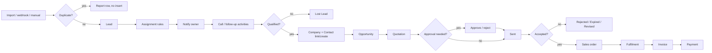

# Architecture — Enterprise CRM 2.0

**Date:** 2026-11-20 · Supersedes nothing. `docs/ARCHITECTURE.md` and `docs/REMEDIATION_CONVENTIONS.md` stay authoritative for conventions; this document adds the enterprise target.

## 1. Current architecture (kept)

```
Browser ──► proxy.ts (Supabase session refresh, CRM/API paths only)
        ──► App Router
              (website)  public marketing site — separate root layout, untouched
              (auth)     /crm/login, forgot/reset password
              (crm)      authenticated shell (requireUser in layout) → pages (Server Components)
              api/**     Route Handlers: requireApiActor() + handle()
        ──► Server Actions / Route Handlers   (thin: auth, zod, call service, revalidate)
        ──► src/server/<module>/*.ts          (business logic: (actor, input), HttpError, transactions)
        ──► Prisma 7 (adapter-pg, privileged connection; RLS does NOT constrain it)
        ──► PostgreSQL (Supabase)  +  Supabase Storage (driver in lib/storage.ts)
```

Rules that every new module follows:

1. **Authorization happens in services.** Pages hide controls for UX only. Capability: `assertCan(actor, "<perm>")` (`src/server/actor.ts`). Record scope: `leadScope(actor)` for leads; owner checks for quotations. Hidden buttons are never the control.
2. **Every business mutation writes an audit row in the same transaction** (`recordAudit` in `src/server/audit/log.ts`, or the module's existing `log()` helper).
3. **Lead inserts go through `server/leads/ingest.ts`**; status/call-status changes call `recordStatusChange`.
4. **Money is `Decimal`**; dates are IST-aware via `lib/time/ist.ts`.
5. **Lists are server-paginated, server-sorted and URL-driven** (`lib/table-params.ts` + `components/ui/data-table.tsx`).
6. **Tests run on embedded PostgreSQL** (`tests/helpers/db.ts`); nothing touches Supabase.

## 2. Permission model

Two layers, both server-side:

| Layer | Mechanism | Phase 1 state |
|---|---|---|
| Capability | `CRM_PERMISSIONS` catalog in `src/lib/permissions/index.ts`; `can(role, perm)` / `assertCan(actor, perm)` | Catalog + grants equal to today's ADMIN/USER behaviour, pinned by `tests/foundation.phase1.test.ts`. Vendor permissions unchanged |
| Record scope | Service predicates: `leadScope`, quotation owner, import-job owner | Unchanged |

**Target (Phase 6, needs D-01):** `Role` + `RolePermission` tables, `User.roleId`, the seven roles from the brief, scope levels per permission (`own` / `team` / `all`). Migration maps `ADMIN → Admin`, `USER → Sales Executive`, so no user loses or gains access on the day of the switch. Existing `assertAdmin` calls migrate to `assertCan` module by module, each with an authorization test for every role.

## 3. Target data model (proposed — nothing below is migrated yet)

Compared against existing models first; no duplicates of existing concepts.

| Concept | Decision | Reuses / relates to |
|---|---|---|
| Audit log | **Extend** `ActivityLog` with nullable `entityType`, `entityId`, `before`, `after` (additive) + index `(entity_type, entity_id, occurred_at)` and `(occurred_at)` | `ActivityLog` (no new AuditLog model) |
| Company (account) | New `Company` (name, industry, website, GSTIN, billing address, owner, tags) + `CompanyAddress` (shipping, many) | Lead gets nullable `companyId`; `Lead.company` text stays |
| Contact | New `Contact` (name, phone, email, designation, companyId, owner, source) | Lead gets nullable `contactId`; `additionalContacts` JSON stays until migrated (D-02) |
| Opportunity | New `Pipeline`, `PipelineStage` (order, probability, isWon/isLost), `Opportunity` (owner, company, contact, lead, value Decimal, expected close, priority, lost reason), `OpportunityStageHistory`, `OpportunityProduct` | Lead statuses are **not** replaced (D-03) |
| Activity / task / note | One `Activity` table: type (CALL, EMAIL, MEETING, FOLLOW_UP, TASK, NOTE, OTHER), subject, body, due, completedAt, outcome, priority, ownerId, assigneeId, polymorphic `relatedType`/`relatedId`, recurrence rule; `ActivityComment` | Lead `followUpDate` remains the source for follow-up presets until dual-write is proven (M3) |
| Ownership history | New `LeadAssignmentEvent` (lead, user, action ASSIGNED/REMOVED/TRANSFERRED, by, at) written in the same transaction as `LeadAssignment` changes | `LeadAssignment` stays the current state |
| Lead extras | Additive columns: `priority`, `qualification`, `tags String[]`, `score Int?`, `scoreBreakdown Json?`, `scoredAt`, `lastActivityAt` | Scoring rules in `ScoringRule` config (D-11) |
| Saved views | `SavedView` (userId, entity, name, params Json, shared, isDefault) | URL params from `lib/table-params.ts` + lead filter params |
| Attachments | Generic `Attachment` (relatedType, relatedId, storagePath, mime, size, uploadedBy) in a new private bucket | `VendorDocument` kept as is |
| Quotation lifecycle | Additive on `Quotation`: `status`, `validUntil`, `revision`, `opportunityId`, `companyId`, `approvedById/At`; new `QuotationRevision` (immutable JSON snapshot) and `QuotationApproval` | Existing totals never recomputed |
| Numbering | Generalize `invoice_counters` usage into `DocumentSequence` (key, prefix, FY, seq) with the same `UPDATE … RETURNING` lock | `InvoiceCounter` (quotation numbers today) |
| Orders / invoices / payments | `SalesOrder(+Item)`, `Invoice(+Item)`, `Payment`, `CreditNote` — only after D-05 | Quotation → order is idempotent via unique `quotationId` |
| Product price history | `ProductPriceHistory` written on price change | `ProductPrice` |
| Notifications | `Notification` (userId, type, title, link, readAt, dedupeKey unique), `NotificationPreference` | — |
| Automation & jobs | `Job` (type, payload, runAt, attempts, lockedUntil, status, idempotencyKey unique), `AutomationRule`, `AutomationExecution` | `IntegrationRun` pattern |
| Roles | `Role`, `RolePermission` (Phase 6) | `UserRole` enum kept during transition |

All money `Decimal`, all FKs explicit, soft delete only where justified (D-09).

## 4. Background jobs (decision D-06)

Today: no scheduler (`vercel.json` crons is empty). Target: a PostgreSQL `jobs` table claimed with `SELECT … FOR UPDATE SKIP LOCKED`, idempotency keys, exponential retry, dead-letter status, and a single "tick" endpoint called by a scheduler (Vercel Cron on a plan that allows minute schedules, or Supabase `pg_cron` + `pg_net`). No in-memory timers. Automation actions run inside jobs with a per-execution depth counter to stop loops.

## 5. Global search (Phase 1)

`/api/search` → `server/search/service.ts`. Per-entity queries run in parallel with each entity's own scope rule, capped at 5 (max 10) rows; LIKE wildcards are escaped. Proposed M1 adds `pg_trgm` GIN indexes so `ILIKE '%term%'` stays index-backed as data grows. The palette (`components/layout/command-palette.tsx`) is an ARIA combobox; recent records are per-user `localStorage` conveniences and re-authorise on open.

## 6. UI architecture

- Design tokens and component classes in `src/app/globals.css`; React primitives in `src/components/ui`. Phase 1 added `DataTable`, `Skeleton`/`TableSkeleton`/`MetricsSkeleton`/`PageSkeleton`, `ErrorState`, `UserAvatar`/`UserChip`, `FormSection`/`FormCard`, and the command palette.
- `DataTable` is a Server Component; state is in the URL (works without JS, bookmarkable). TanStack Table v9 is installed but not used because every list is server-sorted/paged; a client variant for bulk selection can adopt it later (D-08).
- shadcn/ui and Radix are **not** introduced in Phase 1: the token system already provides accessible equivalents, and a second styling stack would fragment the UI. Decision D-08.

## 7. Security review (Phase 1)

| ID | Finding | Severity | Status |
|---|---|---|---|
| E-SEC-01 | Lead and lead-insertion exports were not audited | Medium | **Fixed** in Phase 1 (`recordAudit`), tested |
| E-SEC-02 | Prisma `contains` does not escape `%`/`_`; list filters treat them as wildcards | Low (correctness; scope still enforced) | Fixed in global search; list filters in Phase 2 |
| E-SEC-03 | User-management actions `throw` on validation errors (generic error page instead of a field message) | Low (UX; no leak in production) | Phase 6 |
| E-SEC-04 | CSP is report-only | Medium | Phase 7 (from `SECURITY_AUDIT.md`) |
| E-SEC-05 | No error monitoring / structured logs | Medium | Phase 7 |
| E-SEC-06 | `activity_logs` lacks an `occurred_at` index; audit queries scan as volume grows | Low (perf) | M1 |
| E-SEC-07 | Lead deletes are hard deletes (cascade assignments and history); only the audit row survives | Decision | D-09 |
| E-SEC-08 | `/api/search` is not rate-limited (authenticated, debounced, capped) | Low | Revisit if abused; limiter writes per keystroke would cost more than they save |
| Carried | Exposed DB password not yet rotated; careers shared PIN; buckets/RLS not provisioned on a staging project | Critical/High | Owner action (see `docs/PRODUCTION_BLOCKERS.md`) |

## 8. Workflow (target, end-to-end)



Each arrow is a service call with a permission check, a transaction and an audit row; creation steps carry idempotency keys (e.g. one order per quotation, one payment per reference).
